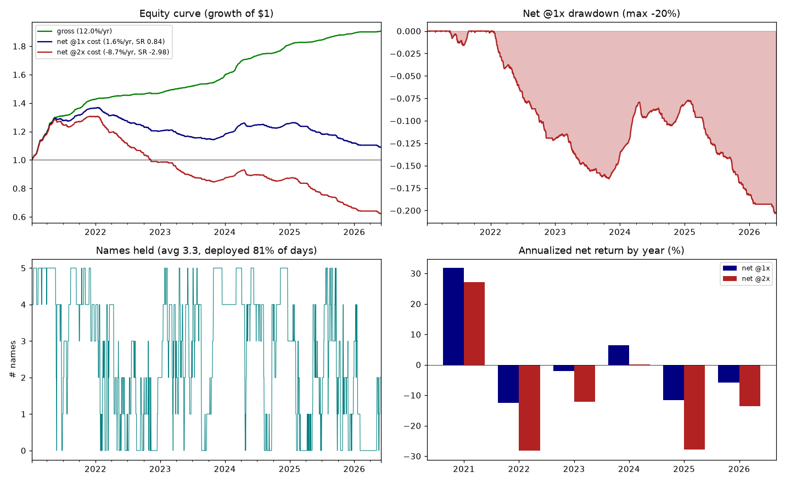

# v0 — baseline edge check

*Single v0 record: the preregistration (written before results, to keep the check honest) and the
result. v0 predates the notebook convention; newer steps are executed notebooks.*

## Question

On liquid Binance majors, does the delta-neutral funding-carry trade (**long spot, short USD-M
perp**) earn a **positive net return after realistic costs**? This is the v0 gate of
`src/strategies/funding_carry/funding_carry_strategy.md`: if yes, the layers (forecasting,
hysteresis, portfolio) are worth building; if no, they won't save it.

## Preregistration (locked before the run)

**Universe:** Binance, 5 liquid majors — `btcusdt, ethusdt, bnbusdt, xrpusdt, solusdt`, each held
+1 spot / −1 perp of equal notional (delta-neutral). Survivorship-optimistic (majors only) → v0 is
an upper bound on the real edge.

**Method (minimal, parameter-light):** per name, annualize trailing funding to APR over a **7-day**
window; hold **every** name whose APR clears a cost-break-even gate (`APR ≥ c_rt/(gate_breakeven_days
× intervals_per_day)`), equal weight, **daily** rebalance, cash if none qualify. Costs booked when
they occur (not amortized).

**Parameters (owner-confirmed):** APR window 7d · `gate_breakeven_days` 30 (⇒ APR floor ≈ 4.6%) ·
perp taker 5 bps · spot taker 10 bps · slippage 2 bps/leg ⇒ **round-trip `c_rt` = 38 bps** ·
holding cost 0.

**Success criteria (the gate) — ALL must hold on 2021-01 → 2026-05:** (1) net ann return > 0,
(2) net Sharpe > 0.5, (3) survives 2× cost, (4) not driven by a single regime.
**Stop rule:** if the gate fails, do **not** add Layers A–I — revisit the premise first.

## Verdict — **v0 FAILS the preregistered gate** (but the gross edge is real)

| gate criterion | result | pass? |
|---|---|---|
| Net ann return > 0 (@1×) | **+1.6%** | ✅ |
| Net Sharpe > 0.5 (@1×) | **0.84** | ✅ |
| Survives 2× cost | **−8.7%, Sharpe −2.98** | ❌ |
| Not driven by one regime | **+31.8% in 2021; negative in 4 of 6 years** | ❌ |

**The carry edge exists** (gross **+12.0%/yr**, compounding to 1.9× over 5.4y) **but costs eat almost
all of it** and the thin survivor is fragile.



## Root cause: turnover, exactly as the doc predicts

Annual turnover is **54×**. At 19 bps one-way that is a **10.3%/yr cost drag** (20.7% at 2×) vs only
12% gross carry. The daily **hard** cost-gate churns names as the noisy 7-day APR crosses the floor.
This is the failure mode the doc calls out — *"the band between θ_in and θ_keep stops churn"*
(**Layer D, hysteresis**). v0 has no hysteresis by design, so it pays the churn tax in full → the
direct motivation for **v1** (see `../v1_layer_d/`).

## Results (full detail)

Period 2021-01-08 → 2026-05-31 (1970 days after 7-day warmup).

| metric | net @1× | net @2× |
|---|---|---|
| annualized return | +1.6% | −8.7% |
| annualized vol | 1.9% | 2.9% |
| Sharpe | 0.84 | −2.98 |
| max drawdown | −20% | −52% |
| gross ann return | +12.0% | +12.0% |
| avg names held | 3.3 | 3.3 |
| annual turnover | 54× | 54× |

Per-year net (@1× / @2×): **2021 +31.8% / +27.2%**, 2022 −12.6% / −28.2%, 2023 −2.1% / −12.2%,
2024 +6.4% / +0.1%, 2025 −11.7% / −27.8%, 2026 −5.9% / −13.5%. The edge concentrated in the 2021
leverage mania; in quieter/negative-funding regimes the churn drag dominates.

## Reproduce

```bash
uv run pytest tests/strategies/funding_carry/
uv run python -m src.strategies.funding_carry.v0.backtest --config strategies/funding_carry/v0.yaml
uv run python -m scripts.report --strategy funding_carry --version v0    # interactive HTML dashboard
```
