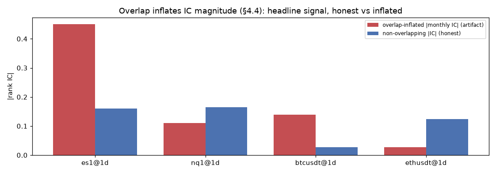
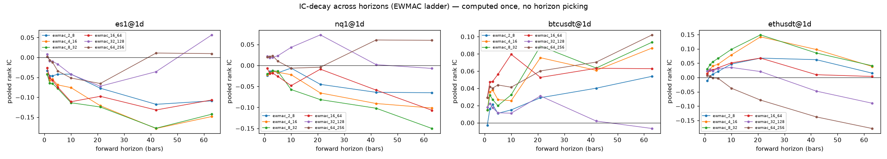
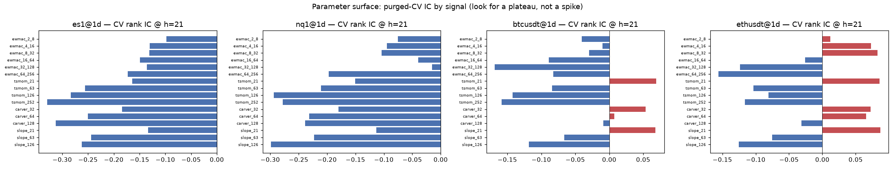

# Trend / Momentum — Research Report

**Date:** 2026-06-23 · **Status:** Exploratory — Rejected on current sample · **Group I (Trend / Momentum)**

## Research question
Do per-instrument **trend / momentum** signals (EWMAC, channels, TSMOM, regression slope),
computed from strictly-past data, carry **predictive content** for forward returns — measured
by rank IC under purged cross-validation and overlap-aware inference? (Signal study: predictive
content only; strategy PnL/sizing is a later phase.)

## Findings
- **Reject — no signal shows significant predictive content on this sample.** Best non-overlapping IC t=1.62 (need |t|>3).
- Large *overlapping* daily ICs are §4.4 artifacts: on non-overlapping samples they collapse (and for BTC flip sign) — see the overlap figure.
- Descriptive separability sits at the permutation baseline — the signals do not discriminate the regime beyond the majority class (measurement only, not edge).
- **Signal study only.** Position sizing, Sharpe, DSR/PBO and costs are deferred to the strategy phase — the signal→position mapping is a separate design step, and a naive `sign(signal)` Sharpe would misrepresent these signals.

## Experiment description
- **Signals (16/instrument):** EWMAC+Baz ladder `(2,8)…(64,256)`, TSMOM `{21,63,126,252}`,
  Carver `{32,64,128}`, regression-slope `{21,63,126}` — all vol-normalized (`src/signals`).
- **Target:** forward log return at horizon h=21; full
  IC-decay computed over `{1…63}` once (no horizon picking).
- **Evaluation (signal study):** purged k-fold + embargo (no label leakage); **headline IC uses
  non-overlapping forward returns** + correlation t-stat (overlap inflates magnitude/significance,
  §4.4). Per-signal detail (signal vs price with long/short classification, IC-decay, fold stability)
  lives in the notebooks under `research/reports/notebooks/`.
- **Signal-study gate:** HLZ **|t|>3** on non-overlapping IC + sign-stable folds + parameter plateau.
  **Deferred to the strategy phase:** position sizing, Sharpe, DSR/PBO, costs — the signal→position
  mapping is a separate design step (`research/preregistration/trend.md`).
- **Firewall:** predictive (tradeability) and descriptive (measurement) results are kept separate.

## Data used
| Instrument | Period | daily bars | usable | indep. obs (h) |
|---|---|---|---|---|
| es1@1d | 2018-06-01 → 2026-06-12 | 2183 | 1677 | 91 |
| nq1@1d | 2019-06-23 → 2026-06-21 | 2180 | 1674 | 97 |
| btcusdt@1d | 2019-12-31 → 2026-06-21 | 2365 | 1859 | 94 |
| ethusdt@1d | 2019-12-31 → 2026-06-21 | 2365 | 1859 | 88 |

Source: CME via Databento (ratio-adjusted continuous front strip), Binance perps (public dumps).
All reads via `src.data.query`.

## Command ran
```bash
uv run python research/trend/run_trend_study.py
```

## Results

### Predictive content (rank IC)
| Instrument | strongest signal | non-overlap IC | t | indep. obs | gate (\|t\|>3) |
|---|---|---|---|---|---|
| es1@1d | `tsmom_252` | -0.160 | -1.53 | 91 | fail |
| nq1@1d | `slope_126` | -0.164 | -1.62 | 97 | fail |
| btcusdt@1d | `ewmac_32_128` | +0.027 | +0.26 | 94 | fail |
| ethusdt@1d | `ewmac_64_256` | -0.124 | -1.15 | 88 | fail |


*Overlap artifact: inflated monthly IC vs honest non-overlapping IC.*


*IC-decay term structure across horizons (EWMAC ladder).*


*Purged-CV IC by signal — a real edge shows a plateau, not a lone spike.*


### Descriptive (measurement only — NOT tradeability)
| Instrument | regime separability (acc vs perm, p) | lead/lag |
|---|---|---|
| es1@1d | insufficient | insufficient |
| nq1@1d | insufficient | insufficient |
| btcusdt@1d | 0.889 vs 0.889 (p=0.13) | 0.893 vs 0.893 (p=1.00) |
| ethusdt@1d | 0.945 vs 0.945 (p=1.00) | 0.945 vs 0.945 (p=1.00) |

---
*Auto-generated by `research/trend/report.py`. Raw numbers: `results/reports/trend_study_run.md`.*
